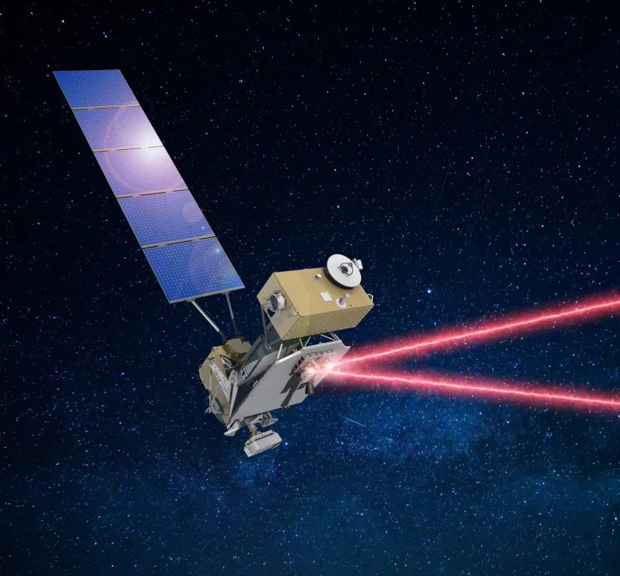

# PAT Laser Tracking System

A bench-scale pointing, acquisition and tracking (PAT) system that locks a laser onto a moving light beacon with closed-loop control, modeled on the terminals used in satellite laser links.

## Synopsis
Our goal is to mirror large-scale satellite laser links on a much smaller scale. The terminal and beacon will both be required to maintain connection using a narrow beam of light.

With the system designed, the two of us will build it around three actions: acquire, track, and measure. First, the terminal searches its field of view to acquire the beacon. Once it has locked on, we move the beacon, and the terminal must keep the connection between them. To do this, a photodiode detects where the beam lands, and a steering mirror adjusts the beam to keep it centered on the photodiode. We then log pointing error over time and tune the system to reduce latency. In the final phase, we add a blinking signal to the same beam, which the beacon decodes into usable data.

Our major inspiration for this project is NASA's LCRD system.

https://www.nasa.gov/directorates/stmd/tech-demo-missions-program/laser-communications-relay-demonstration-lcrd-overview/

{{sheet: bom.xlsx}}
