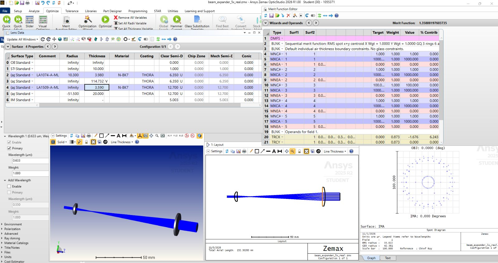
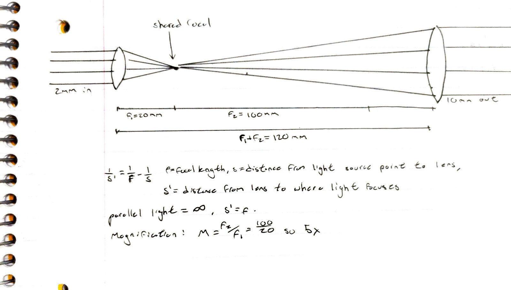
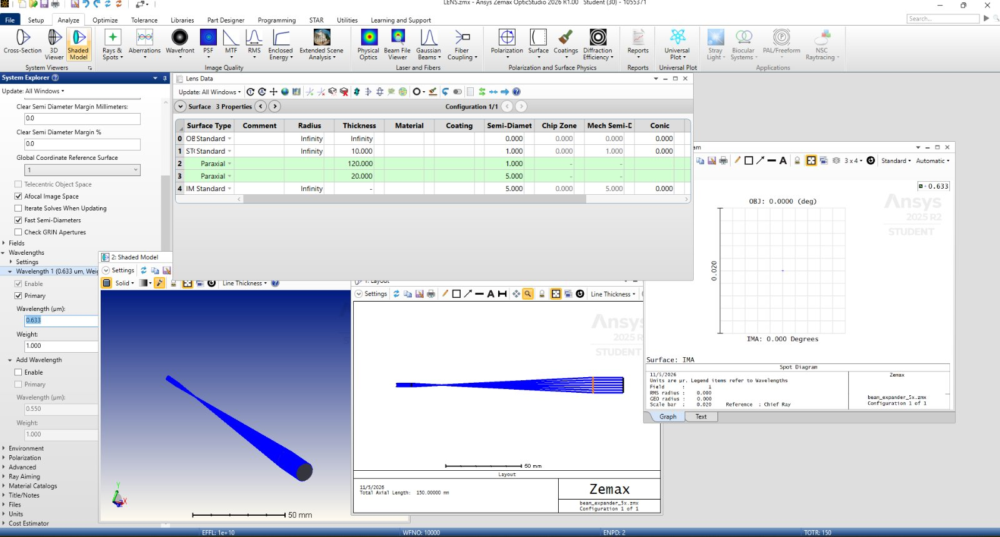

<!--
  PROJECT LOG. Easiest way to post: open admin.html on the live site.
  Each entry starts with:  ## YYYY-MM-DD | Title | Name   (newest at the top)
-->

## 2026-11-05 | Ideal 5x Keplerian Laser Beam Expander at 632.8 nm in Opticstudio | Kayson Felix-Davila

Today I learned Keplerian expanders work by allowing the beam to focus, allowing it to spread, then "recollimate." I also learned how to calculate the lens spacing under afocal image space conditions:the lenses must share a focal point, so the spacing is simply f₁ + f₂.

I made two simulations: ideal and one using real parts.

Then I swapped in real Thorlabs lenses using OpticStudio's catalog. I  briefly learnt how to read lenses from this catalog. I chose LA1074-A and LA1509-A. Real lenses have thickness which basically meant the spacing came out shorter. I estimated 115 mm by hand, and "collimating" by adjusting our gap thickness in the software manually gave me a solid number at 114.73 mm. The output was still 10 mm, but now with a tiny leftover angular spread of 33 µrad from spherical aberration. I learned that this abberation is unavoidable with these simple lenses. 

I worked out the focal lengths and lens spacing by hand before building the simulated model. My notebook page is below.

### My ideal design conditions:
Wavelength: 632.8 nm (HeNe red)
Input beam: 2 mm diameter, afocal image space; parallel light in, parallel light out
Lens 1: ideal paraxial lens, f₁ = 20 mm
Lens 2: ideal paraxial lens, f₂ = 100 mm
Lens spacing: f₁ + f₂ = 120 mm
### My Results
Paraxial ray trace confirmed rays leave parallel with zero angular error
Output beam: 10 mm diameter (5× magnification, M = f2 / f1)

###Real lens design conditions:

Wavelength: 632.8 nm (HeNe red)
Input beam: 2 mm diameter, afocal image space; parallel light in, parallel light out
Lens 1: Thorlabs LA1074-A, N-BK7 plano-convex, f = 19.93 mm, R = 10.3 mm, CT = 3.98 mm, Ø12.7 mm
Lens 2: Thorlabs LA1509-A, N-BK7 plano-convex, f ≈ 100 mm, R = 51.5 mm, CT = 3.59 mm, Ø25.4 mm
Orientation: curved sides facing the parallel light
Lens spacing: 114.73 mm (115.0 mm hand estimate)

###Real lens results:

Output beam: 10.01 mm diameter (5.00×)
RMS angular spread: 33 µrad (GEO 42 µrad)
With the gap 15 mm too short: 5761 µrad RMS

